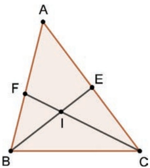

## A Note

We have seen that ‘If X then Y’ can also be written as ‘X implies Y’. These are not the only ways to express this meaning. It can be conveyed through other words and sentence structures as well. For example, ‘Y when X’ also gives the same meaning. The following two statements, for instance, have the same meaning.

**Proposition:** If a number is a perfect square, then it has an odd number of factors.

**Proposition:** A number has an odd number of factors when it is a perfect square.

## Think and Reflect

1. Identify real-life examples in which a proposition is true but not the converse. Give nice counterexamples!

2. Give more examples from geometry as well as number theory in which a proposition is true but not its converse. Give appropriate counterexamples.

## Exercise Set 9.1

Frame the converse for each of the propositions in Questions 1–12. Then, determine if each of the two statements is true or not. Justify the true statements and give a counterexample for each false statement.

1. If two lines are parallel, then the corresponding angles formed by a transversal are equal.

2. If a quadrilateral is a square, then all its angles are equal.

\*3. Given any ∆ABC, let us bisect the angles at B and C. The bisectors meet at the incentre I of the triangle.

Now extend the bisectors beyond I till they meet the opposite sides at E and F respectively, as shown.

**Proposition:** If $\mathrm{AB} = \mathrm{AC},$ , then IE = IF.

Fig. 9.1