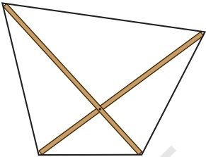

17. We have identified different types of quadrilaterals — squares, rectangles, parallelograms, rhombi, kites and trapezia. One can identify more types (e.g., we could create a category of quadrilaterals that have equal-length opposite sides).

Suppose we have identified a category of quadrilaterals called Q, and we have to construct a quadrilateral of this type. For this, we are to use two thin sticks, put them together as diagonals so that the quadrilateral obtained by joining their endpoints is of type Q (see the Fig. 9.2).

Fig. 9.2

(i) Suppose Q satisfies the following property.

If a quadrilateral is of type Q, then it has equal-length diagonals.

(a) Should the two sticks be of equal length? Why or why not?

(b) Will it matter how the two sticks are put together?

(ii) Instead of the property mentioned above, suppose Q satisfies the following property.

If a quadrilateral has equal diagonals, then it is of type Q. What will be your answers to (a) and (b) now?

## Chapter Summary

• A **proposition** is a statement that is true or false.

The **converse** of the proposition ‘if P then Q’ is the proposition ‘if Q then P’.

It can happen that a proposition is true while its converse is false. It can also happen that both the proposition and its converse are true, or both are false.

**Counterexamples** are instances that demonstrate the falsity of a given proposition.