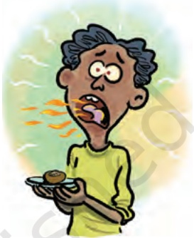

3. A 600 mL solution with 5% salt is mixed with a 300 mL solution with 8% sugar. What are the concentrations of salt and sugar in the mixture?

(i) Salt: 5%, Sugar: 8%

(ii) Salt: 13%, Sugar: 3%

(iii) Salt: 6%, Sugar: 6%

(iv) Salt: 5.55%, Sugar: 8.88%

(v) Salt: 3.33%, Sugar: 2.67%

(vi) Salt: 4.1%, Sugar: 7.08%

4. At a panipuri (golgappa) stall, the concentration of spice in the pani (spiced water) was 8%. Many customers complained that it was too spicy. What quantity of regular water should be mixed into the 10 litres of pani so that the spice level is reduced to $\left( { \frac { 3 } { 4 } } \right) ^ { \mathrm { t h } }$ of the original concentration?

5. A physical fitness evaluation is being undertaken. The final marks are calculated by combining the marks for strength, flexibility, and agility in the ratio 4 : 5 : 6. Rashi has scored 60, 65, and 70. Keerthi has scored 55, 65, and 75 respectively.

(i) Find out whose total is more without calculating.

(ii) What are their final marks?

6. A restaurant collected ratings from 10 customers on a scale of 1 to 5. The resulting data is shown in the table below.

|  | 5 | 4 | 3 | 2 | 1 |
| --- | --- | --- | --- | --- | --- |
| Food | 5 | 3 | 2 | 0 | 0 |
| Ambience | 0 | 4 | 5 | 1 | 0 |
| Service | 1 | 2 | 2 | 4 | 1 |

What is the average rating if the metrics are combined with the weights food : ambience : service = 6 : 5 : 4?

7. The following table shows the weight data of langurs in an animal facility. Without doing any computations, can you tell