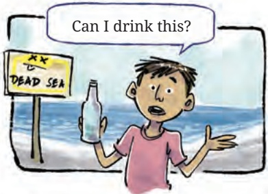

| Water Source | Salinity |
| --- | --- |
| Dead Sea | ≈ 34% |
| Other seas and oceans | ≈ 3.5% |
| Ground water | ≈ 0.01% |
| Purified drinking water | ≈ 0.001% |

(i) What is the salinity of the mixture if he mixes 1 litre of water from the Dead Sea with 2 litres of purified drinking water?

(ii) Is it possible to mix water from the Dead Sea and purified drinking water to get a mixture with the salinity of groundwater? Why/Why not? What quantity of purified drinking water should Dorjee mix with 1 litre of water from the Dead Sea to get a mixture having the salinity of groundwater?

(iii) Is it possible to mix water from the Dead Sea and groundwater to get a mixture with the salinity of purified drinking water? Why/Why not? What quantity of groundwater should he mix with 1 litre of water from the Dead Sea to get a mixture having the salinity of purified drinking water?

## 10.2 Visualising and Interpreting Data

## 10.2.1 Stacking Columns

The following table shows the average weekly expenditure, in rupees (\`), of three families across categories. What would a cluster-column chart for this data look like?

Table 10.2

|  | Housing | Food | Education | Transportation | Healthcare | Recreation |
| --- | --- | --- | --- | --- | --- | --- |
| Family A | 1940 | 1700 | 1280 | 1200 | 1770 | 535 |
| Family B | 1750 | 1546 | 1500 | 1280 | 1210 | 0 |
| Family C | 950 | 1700 | 1540 | 1400 | 1300 | 150 |