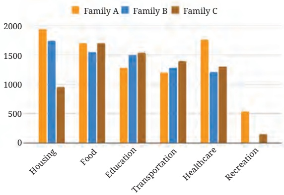
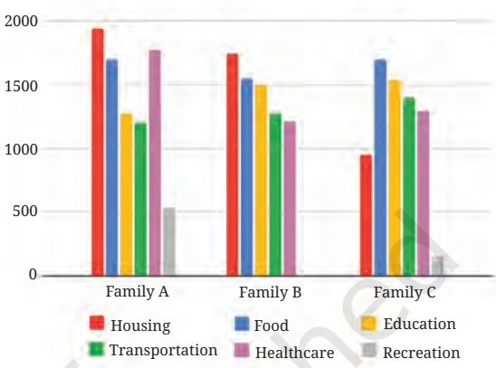

There are two possibilities depending on the choice of the cluster; the clusters can be categories or families:

Comparing expenditure of families across categories

Comparing category-wise expenditure of each family

Fig. 10.1: Two cluster-column graphs showing different ways of visualising the data in Table 10.2

Answer the following questions based on the charts above. Try to answer each question by looking at Choice 1 first, and then Choice 2. Which was easier?

1. Which family spent the least on housing?

2. Which family spent the most on healthcare?

3. Approximately how much did Family A spend on education?

4. Which category did Family B spend most on?

5. Did Family A spend more on food or on healthcare?

You may have found Choice 1 more suitable to answer Questions 1 and 2, and Choice 2 more suitable to answer Questions 4 and 5.

The choice of the cluster-column chart depends on what the primary focus is — comparing different families’ expenditures in each category (Choice 1) or comparing category-wise expenditures within each family (Choice 2).

Find the answers to the following questions.

6. Which family spent the least amount overall?

7. Approximately how much did Family C spend overall?