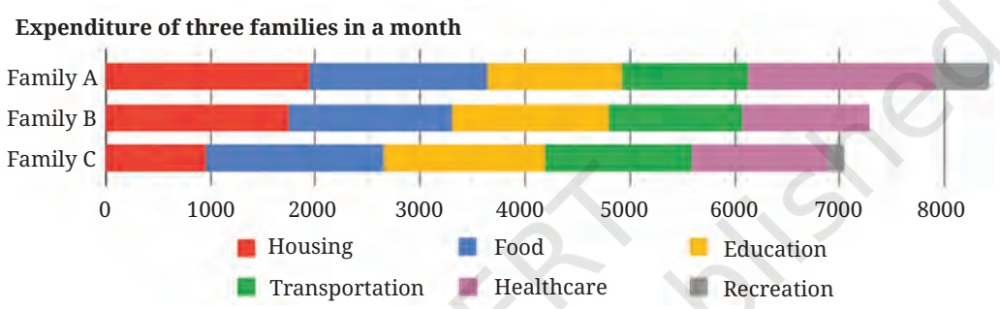

8. Approximately what percentage of Family C’s expenses were on housing?

Was it as straightforward to answer these questions as the earlier questions?

Is there a visualisation that makes it simpler to answer such questions?

Look at the following visualisation of the same data. Try to understand how the chart is organised and answer the three questions above.

Fig. 10.2: A Stacked Bar Chart of the data in Table 10.2

Such a graph/chart is called a **stacked bar or column chart**. Bars within a cluster are joined one after the other in a particular order. **Stacked bar charts are used when we want to compare the totals but also want to keep track of the components that make up the totals.** Here, the total length of a full stacked (combined) bar represents the total expenditure of a family in that month. Also, the length of a smaller bar and the full stacked bar can be compared to get an estimate of what fraction or percentage the smaller bar makes up of the full stacked bar.

Now, use the stacked bar chart to answer the Questions 1–5 shown earlier.

Is it possible? Is it easy? If not, what made it harder than before?

Except for the first small bar, the rest of the stacked small bars do not begin from 0. This makes it a little harder to estimate the quantity corresponding to a bar. Also, bars across clusters need not have a common base or a starting point. So, comparing bars within clusters and across clusters may be harder. However, seeing the totals of all the clusters is easier.