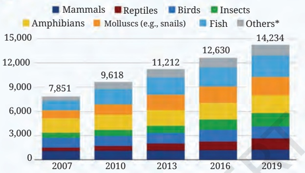

## Exercise Set 10.4

1. The following stacked column chart shows the number of animal species in the IUCN Red List, by class, over time.

The Number of Endangered Species is Rising

Number of animal species of the IUCN Red List, by class

\* Other invertebrate (spineless) animals, such as crustaceans, corals and arachnids (spiders, scorpions)

Source: IUCN Red List

statista

The International Union for Conservation of Nature (IUCN) Red List is a large, regularlyupdated database that tells us the extinction risk of species across the world. It classifies species into groups such as Least Concern, Vulnerable, Endangered, Critically Endangered, Extinct in the Wild and Extinct, based on scientific data about their numbers, trends and habitats.