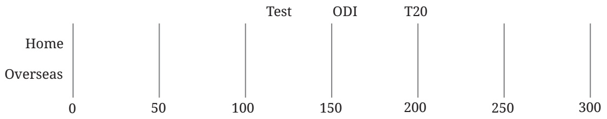
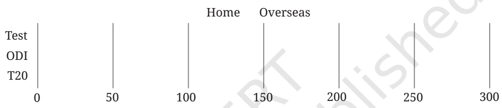
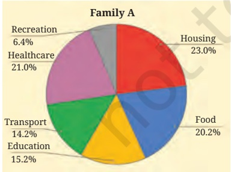
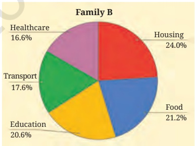
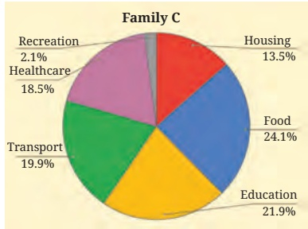

(i) comparing the total wickets taken at home vs. overseas:

Wickets taken at home vs. overseas

(ii) The total wickets taken in each format:

Wickets taken in different formats

## 10.2.2 An Alternative to Pie Chart

Try answering the following question based on the expenditure stacked bar chart you saw earlier:

Which family has the smallest share of their total expenditure towards healthcare?

Was it easy?

If not, what visualisation can help answer such questions easily? Last year, we learnt how pie charts can capture proportions of quantities. Let us visualise this data through pie charts:

Fig. 10.3: Pie charts of data of each family in Table 10.2

Now, consider the following visualisation showing proportions for the same data: