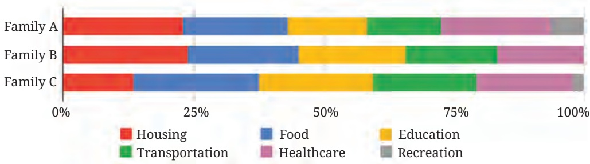
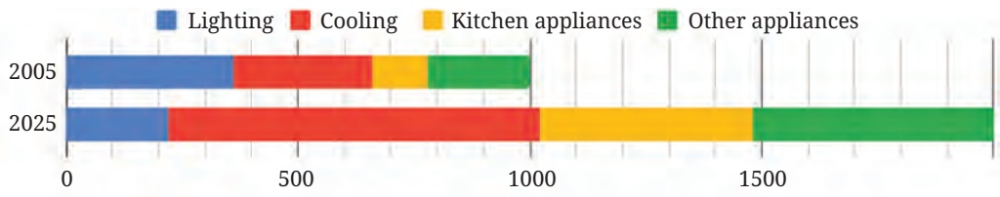

Relative expenditure of families across categories

Fig. 10.4: A 100% stacked bar chart of data in Table 10.2

Here, the total expenditure of each of the three families is shown by a stacked bar of a fixed length. The lengths of the smaller bars in each stacked bar are proportional to the corresponding expenditures of that family. Such a chart is called a **100% stacked bar chart**. It is similar to a pie chart — the complete angle in a pie chart is split proportionately based on the quantities, whereas here, a fixed length is split proportionately.

In pie charts, comparing angles in different orientations may be difficult. It may be easier to compare lengths across stacked bars. However, even in 100% stacked bar charts, if the lengths of a particular bar are similar across the stacked bars but the location is different, comparison may be difficult, as in the chart above.

## Powering Up!

**Example 7:** The average category-wise daily electricity consumption of a house, in kWh, in 2005 and 2025 is shown in the table below. The corresponding stacked bar chart is also shown.

|  | Lighting | Cooling | Kitchen appliances | Other appliances |
| --- | --- | --- | --- | --- |
| 2005 | 360 | 300 | 120 | 220 |
| 2025 | 220 | 800 | 460 | 520 |

