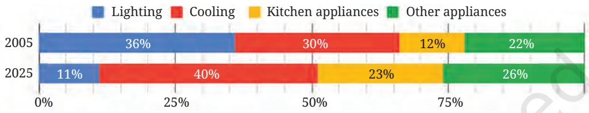
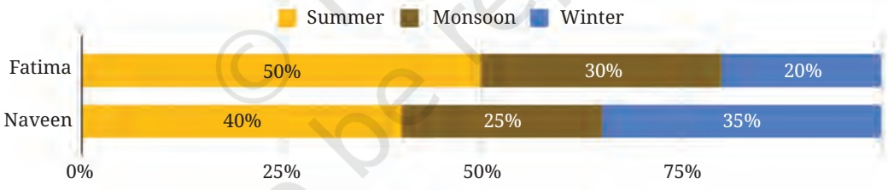

Make the corresponding 100% stacked bar chart.

In 2005, the total unit consumption was $360+300+120+220=$ 1000 units.

The percentage share of lighting in this was $\frac{360}{1000} \times 100 = 36\%.$

Similarly, the percentage share of cooling, kitchen appliances, and other appliances was 30%, 12%, and 22% respectively.

The calculation for the year 2025 can be done in the same way.

What do you observe? What do you find interesting in the data/graphs? Discuss with others.

## What Can We Infer?

**Example 8:** The 100% stacked bar below compares the proportion of flowers blooming in Fatima’s garden and Naveen’s garden across seasons.

Proportion of flowers that bloomed across seasons

Which of the following statements can be inferred from this chart?

(i) In Fatima’s garden, there were more blooms in the summer than in the monsoon.

(ii) In summer, Fatima’s garden had more blooms than Naveen’s garden.

(iii) In winter, Fatima’s garden had fewer blooms than Naveen’s garden.

(iv) The total number of flowers, across seasons, is the same in both gardens but it varies in each season.

(**Hint:** Find out the blooms per season in each garden if both the gardens had the same total number of blooms over the year. Similarly find out what happens if the totals are very different.)