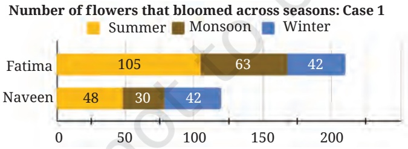
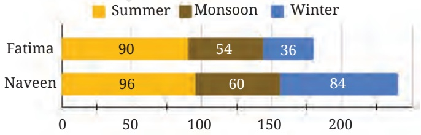

What does the 100% stacked bar tell us?

In each garden, the total number of flowers for the whole year is shown as one bar and is taken as 100%. The colours show what fraction of that total bloomed in each season. So for Fatima’s garden, the bar tells us: 50% of her flowers bloomed in summer, 30% in monsoon, and 20% in winter. For Naveen’s garden, the bar tells us: 40% in summer, 35% in monsoon, and 25% in winter.

**Statement (i):** It compares seasons within the same garden (Fatima’s). So, within Fatima’s garden, the summer part is the largest fraction. This means she actually had more flowers in summer than in monsoon. So, (i) must be true.

**Statements (ii) and (iii):** These compare across gardens in the same season.

For example, in statement (ii), Fatima has a higher percentage in summer (50%) than Naveen (40%). But the chart does not tell us how many flowers they each had in total. Naveen’s total could be much larger. Then even 40% of Naveen’s total might still be more flowers than 50% of Fatima’s total. That means we cannot be sure who has more flowers in that season. Hence, (ii) and (iii) cannot be inferred from this graph.

**Statement (iv):** A 100% stacked bar chart always shows each bar as ‘100%’ of that garden’s total. It does not tell us whether the totals for the two gardens are equal or not. Many different total numbers can give the same 100% bar. Therefore, we also cannot say anything about the total over the whole year from this graph.

A 100% stacked bar chart helps us compare fractions/percentages inside each garden, but it does not tell us the actual numbers of flowers.

Two possible stacked bar charts are shown below for the 100% stacked bar chart we just saw.

$$
\frac{105}{210} \times 100 = 50\% \quad \frac{63}{210} \times 100 = 30\% \quad \frac{42}{210} \times 100 = 20\%
$$

$$
\frac{48}{120} \times 100 = 40\% \quad \frac{30}{120} \times 100 = 25\% \quad \frac{42}{120} \times 100 = 35\%
$$

Number of f lowers that bloomed across seasons : Case 2

$$
\frac{90}{180} \times 100 = 50\% \quad \frac{54}{180} \times 100 = 30\% \quad \frac{36}{180} \times 100 = 20\%
$$

$$
\frac{96}{240} \times 100 = 40\% \quad \frac{60}{240} \times 100 = 25\% \quad \frac{84}{240} \times 100 = 35\%
$$