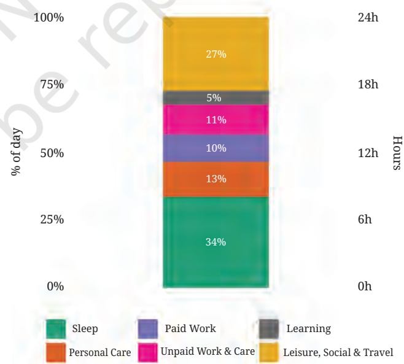

Notice that the percentage of flowers that bloomed in summer is more in Fatima’s garden but this doesn’t say anything about the actual number — Fatima’s garden has more blooms than Naveen’s in summer in Case 1 but her garden has fewer blooms than his in Case 2. Also, in Case 1 both Fatima’s and Naveen’s garden had 42 blooms but the respective percentages are different.

## Think and Reflect

1. What does this say about the scope of the stacked bars and 100% stacked bars?

2. Given a stacked bar chart can we make a corresponding 100% stacked bar chart?

3. Given a 100% stacked bar chart can we make a corresponding stacked bar chart?

4. What kind of inferences or comparisons can be made from a stacked bar chart and in a 100% stacked bar chart?

## A Typical Day

**Example 9:** The following chart shows the time spent on different activities in a day by the average Indian. What do you notice? What do you wonder about?

You may point out that you don’t do much work and that your parents don’t spend any time learning. Note that this strip is representative of people across ages, genders, regions, social/family backgrounds, etc., across India.

The Average Indian’s day

Source: National Time Use Survey 2024

Fig. 10.5: Time spent on different activities in a day by an average Indian (Values are rounded off)