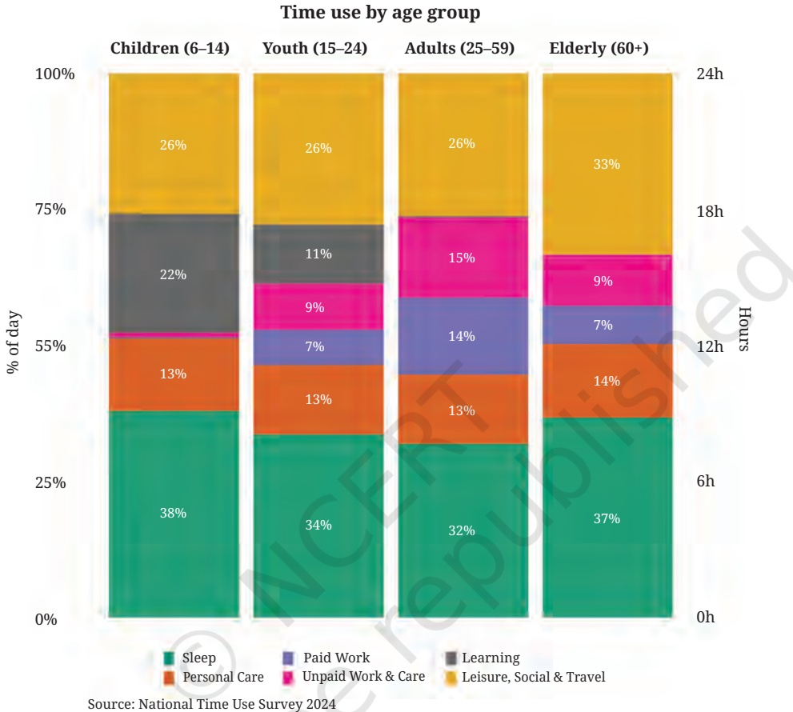

When we visualise the same data by grouping ages, we get the following stacked column chart:

Fig. 10.6: Age-wise grouping of data (Values are rounded off)

## Think and Reflect

1. What do you find interesting in the chart above? What can you infer? Discuss.

2. Do you remember the sleep time over age trend that you studied last year? Does that trend align with this chart?

3. Can you explain why the learning time of people in the age group 15 – 24 has reduced significantly compared to that of the age group 6 – 14?

4. Do adults spend about an equal amount of time in paid and unpaid work? What do you think?