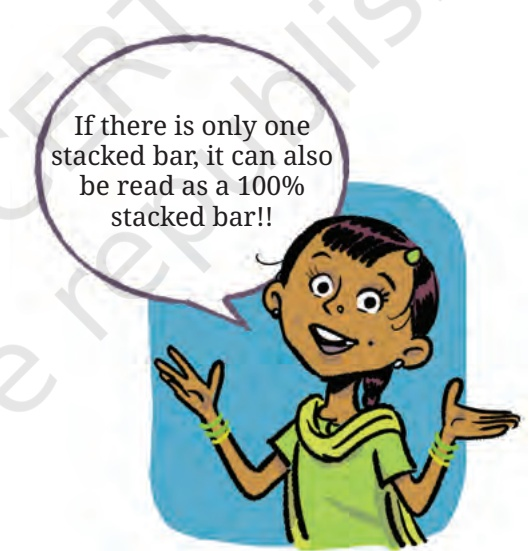

There might be a very small fraction of people whose day is similar/ close to that of the average Indian. As we saw here, looking at only the average of a diverse collection often hides the differences and nuances within the data. We observed age-specific activity trends using this chart, which gave us a better idea. We could break these down further with respect to gender to examine any gender-specific trends within age groups.

You may wonder if there are differences across regions (e.g., rural and urban), or income, etc. You may be curious to look into the details — such as, what is included under personal care for different groups, or how does time spent on travel vary across cities and towns/villages? What we spend time on also depends on the times we live in. Clearly, a few decades ago, people didn’t have access to mobile phones or televisions. Only time will tell what such charts will look like after a few decades. We may also ask — how do people in other countries spend their time? How similar or different are the trends?

What type of chart is this — a stacked bar chart or a 100% stacked bar chart?

It is both! It is a stacked bar because each small bar represents the amount of time spent on a certain activity. It is also a 100% stacked bar as each stacked bar’s total is the same, i.e., 24 hours, and the lengths of the smaller bars within and across the stacks also represent the relative proportions of time spent.

If there is only one stacked bar, it can also be read as a 100% stacked bar!!

## Think and Reflect

Do you remember the ‘What Can A Strip Say?’ activity from last year? In each strip, if we club the tiny strips belonging to each activity together, will we get a 100% stacked bar chart like the one in Fig. 10.6?