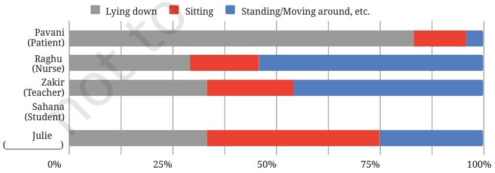

# Exercise Set 10.5

1. The smart watch data of 5 people was tracked from Monday to Friday. The recorded data tells us how many hours each person spent lying down, sitting, and standing or moving around, etc., as shown in the following table.

Table 10.3: Average number of hours spent per day (Monday – Friday) lying down, sitting, and standing or moving around, etc., of 5 people

|  | Lying down | Sitting | Standing or Moving around etc. |
| --- | --- | --- | --- |
| Pavani (Patient) | 20 | 3 | 1 |
| Raghu (Nurse) | 7 | 4 | 13 |
| Zakir (Teacher) | 8 | 6 | 10 |
| Sahana (Student) |  |  |  |
| Julie (___________) | 8 | 10 | 6 |

(i) How much time does Sahana spend per day in each of these body-states? Make a reasonable guess and fill her row in the table.

(ii) Guess what activity or work Julie could be engaged in based on the data. Find out what your classmates’ guesses are.

(iii) Complete the chart below based on the tabular data.

