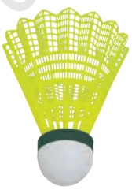
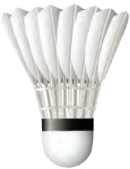

## Think and Reflect

Will the bars look similar if a different teacher’s data is considered instead of Zakir’s?

2. Will the bars look different if the data for all 7 days of the week is considered?

3. Some bars in the chart may also match people doing other kinds of work/activities. Can you think of any? Discuss.

## End-of-Chapter Exercises

1. In cricket, the **run rate** is the average number of runs scored per over. In a T20 match, a team scored 6 runs in the first over making the run rate 6.

(i) In the second over they scored 12 runs. What is the run rate now?

(ii) After Over 19, their run rate was 6. What is the run rate after 20 overs given the team made 12 runs in the last over?

2. Five friends who play badminton surveyed the city and collected the price of shuttlecocks across brands and types (Nylon and Feather). The following is the list of the prices, in rupees (\`), that each one compiled.

Yusuf: 40(N), 105(N), 383(F), 108(N), 165(F), 116(F)

Nylon shuttle

(N)

Feather shuttle

Srikanth: 194(N), 85(N), 93(N), 121(N)

(F)

Kashvi: 49(N), 297(F), 105(N), 275(F), 40(N)

Prasanna: 124(N), 333(F), 182(N), 258(F)

Gracy: 220(F), 458(F), 129(F), 183(N)

Can you describe a way they can work together to find the average price of a shuttlecock across types?

(i) Each one calculated the average of the prices they had gathered. Suppose these are $a _ { \mathrm { y } } , \; a _ { \mathrm { s } } , \; a _ { \mathrm { k } } , \; a _ { \mathrm { p } } , \; a _ { \mathrm { g } }$ respectively. Write an expression that gives the combined average.

(ii) Suppose $a _ { \mathrm { n } } , a _ { \mathrm { f } }$ are the average prices of the nylon shuttlecocks and the feather shuttlecocks, respectively. Write an expression that gives the average price of a