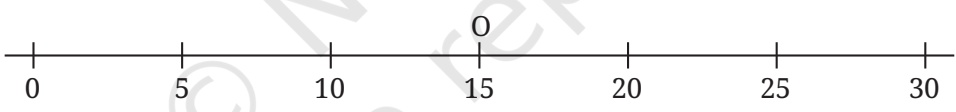

shuttlecock. Will this be equal to the answer we got using the method in the previous part?

3. Shreyas holds 25 shares of a company at an average price of ₹150 and Vaishnavi holds 5 shares of the same company at an average price of ₹150.

(i) Shreyas buys 10 shares of this company at a price of ₹30 each. What is the average price per share for him after the purchase?

(ii) Vaishnavi buys some shares of this company at a price of ₹30 each and the average price per share for her after the purchase is ₹70. How many shares did she buy?

4. (Pṛthūdakasvāmī, commentary on Brahmagupta's Brāhmasphuṭasiddhānta, c. 864 CE) A “hasta” (meaning "forearm") refers to a unit of length measuring around 18 inches.

A pool 30 hastas long is dug to different depths along its length. It is divided into 5 sections having lengths 4, 5, 6, 7, and 8 hastas, and is dug to depths of 9, 7, 7, 3, and 2 hastas, respectively. Find the mean depth of the pool.

5. Suvarna had purchased 1g gold at ₹15k (short for ₹15,000). This is shown by point O denoting the average price of gold that she possesses. Six different scenarios are given below for her next transaction. For each scenario estimate and mark the average price of gold she will have after the transaction.

(iii) Purchase 1g gold at ₹10k

6. Given some data with corresponding weights, how would the weighted average change if all the weights are doubled? If required, experiment with some data. What do you observe? Justify your answer using algebra.

7. Answer the following questions based on the graph.

(i) In 2003, approximately how many total objects were found orbiting Earth in space? In what year did this number double?

(ii) Find the approximate number and share of payload objects and other objects in the year 2025.

(iii) What can you say about the number of payload objects over time, and the number of other objects over time? What can