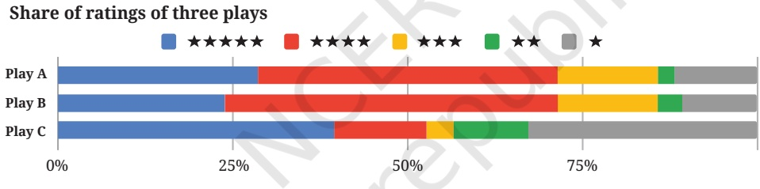
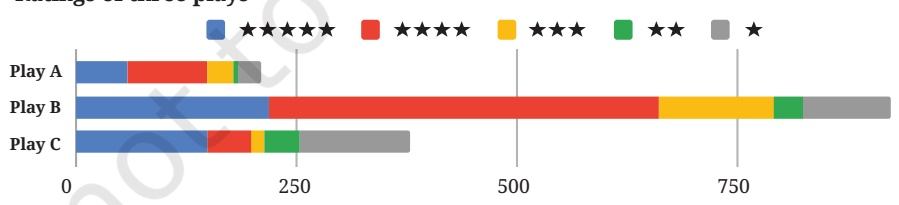

(i) Identify the correct inference(s) from the statements given.

(a) More schools have a playground in Haryana compared to Uttarakhand.

(b) Approximately every 2 out of 3 schools in Arunachal Pradesh have a playground.

(c) Punjab has the highest number of schools with a playground.

(d) Suppose it is given that Maharashtra has more schools than Telangana. Then the number of schools having a playground is more in Maharashtra.

(ii) Using the information given, can we find the nation-wide percentage of schools with a playground? If not, what additional information is needed?

## 9. Decision Dilemma:

(i) Which of the plays would you choose to watch based on the following chart?

Share of ratings of three plays

(ii) The corresponding stacked bar chart is shown below. Would you change your decision after looking at this chart? Why/ Why not? Discuss.

Ratings of three plays

10. A triathlon is an endurance race consisting of swimming 3.8 km, cycling 180 km, and running 42.2 km. Athletes compete for the fastest overall time, completing each segment in that order. The following table shows the finish time of 3 athletes in each segment.