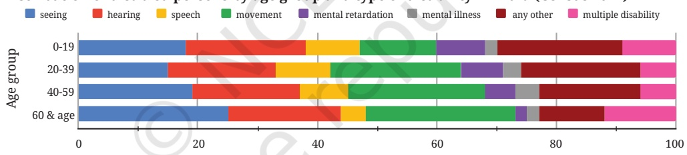

Distribution of disabled persons by age group and type of disability in India (Census 2011)

Table 10.4: Finish time of three athletes in each segment of a triathlon race (values in hh : mm)

|  | Swimming | Cycling | Running |
| --- | --- | --- | --- |
| Athlete 1 | 01:08 | 05:00 | 03:15 |
| Athlete 2 | 01:05 | 05:10 | 03:35 |
| Athlete 3 | 01:22 | 05:55 | 03:50 |

(i) What is a suitable representation of this data — a stacked bar chart or a 100% stacked bar chart? Why do you think so?

(ii) Suppose a 100% stacked bar chart is drawn. Which of the following question(s) can be answered by looking at just that chart?

(a) Who finished the race first?

(b) Approximately what fraction of their race time did Athlete 1 spend cycling?

(c) Which athlete took the longest for running?

11. Look at the following graph. What do you notice? What do you wonder? Write your inferences.

12. **Individual project:** Do at least one of the following.

(i) Recall the previous day and fill in the approximate time spent lying down, sitting, and standing/moving around, etc. Ask at least 2 of your family members about their day and fill it in. Alternatively, you can choose to track just your own body-state for any one of the weekdays, Saturday, and Sunday. Visualise it using a stacked bar chart. Discuss with your class how you arrived at the estimated time spent in each state.

(ii) Visualise your family’s monthly expenditure using a 100% stacked bar chart.

(a) First, identify the expense categories in your family budget.