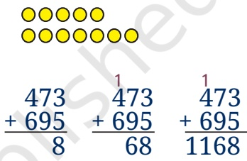

# The World of Algorithms

These days the word ‘algorithm’ pops up everywhere. What exactly is an algorithm? What does it have to do with mathematics?

## 11.1 Adding Numbers

We first learned to add numbers by counting the sum explicitly. To add 5 and 7, we would draw 5 dots to represent the number 5, then draw 7 more dots to represent the number 7, and finally count the dots, 12, to get the answer. Imagine adding large numbers this way, for instance 473 + 695!



Fortunately, we discovered a much faster way to add numbers. We wrote the numbers one below the other in the Indian number system, with the rightmost digit aligned. We then added each column from right to left, remembering to add a carry to the left if the total was equal to or more than 10.

## 11.1.1 Adding Numbers Digit by Digit

This is an example of an **algorithm**, a step-by-step procedure to arrive at an answer. We describe an algorithm by writing down the steps as precisely as possible. For instance, here is one way to describe our addition algorithm.

```txt
Algorithm to add two numbers
1. Write the numbers one below the other in the Indian base-
ten place-value system so that the digits are aligned
from right to left.
2. Add the rightmost digits.
– If the sum is less than 10, write the sum directly
below the two digits. Set the value of carry to 0.
– If the sum is more than 10, write the units digit of
the sum directly below the two digits. Set the value
of carry to 1.
```