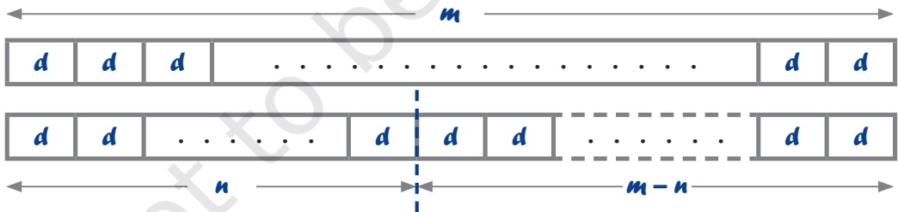

As we did for adding, can we find an algorithm for gcd where the effort is proportional to the number of digits in the number, rather than the value of the number?

## 11.3.3 Euclid’s Subtraction Algorithm

An elegant solution to achieve this was written down by Euclid, in his book Elements. Historians believe that other Greek mathematicians knew of this algorithm before Euclid, but he was the first to put it down in writing.

## Reducing a problem to a simpler one

The original version of Euclid’s algorithm makes use of the following observation. Let us assume that $m \geq n$ . Then, gcd(m, n) is the same as gcd(n, m – n).

Why is this the case?

Let d be a common divisor of m and n. Then we can write m as ad and n as bd, where a and b are natural numbers. This means that m – n = ad – bd = (a – b)d, so d is also a divisor of m – n.

On the other hand, if d divides both n and m – n, then n = xd and m – n = yd for some natural numbers x and y. This means that n + (m – n) = m = xd + yd = (x + y)d, so d also divides m.

This is shown visually below. If we can ‘tile’ m and n using blocks of size d, we can also tile m – n by blocks of the same size. In fact, Euclid used a similar pictorial proof to justify his algorithm.

Fig. 11.1: Justification for Euclid’s gcd algorithm

This observation tells us that any common divisor of m and n is also a common divisor of n and m – n, and the converse is also true. Hence the set of common divisors are the same in both cases, which means that gcd(m, n) = gcd(n, m – n).

Euclid’s algorithm reduces the problem of finding gcd(m, n) to that of finding gcd(n, m – n). The second problem involves smaller numbers, so it should be a simpler problem to solve.