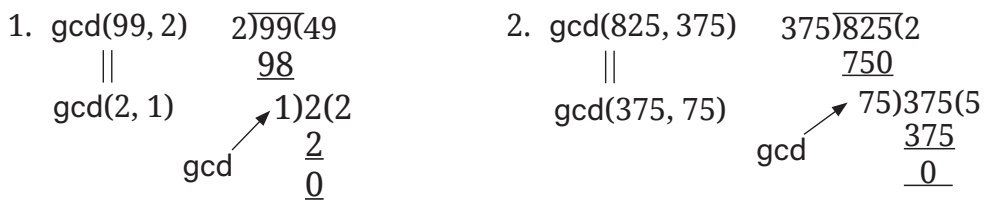
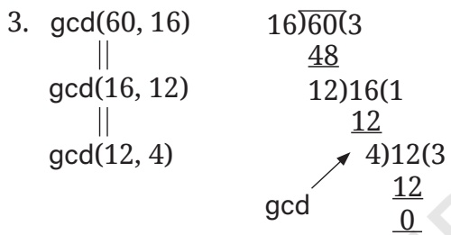

The above modified algorithm can be carried out concisely using the “long division” method given by Indians at least from the time of Āryabhaṭa. We illustrate the method through the following examples—

Here is another example—

In fact, it can be shown that the number of reductions needed in Āryabhaṭa’s division algorithm is now proportional to the number of digits in m and n. Unfortunately, the justification for this fact is too involved to present here, but you will learn about it in future grades.

## A Pinch of History

The influential Persian mathematician Al-Khwārizmī (780–850 CE), a scholar at the “House of Wisdom” in Baghdad, developed a great liking for Indian mathematics. He learnt Sanskrit, and around 820 CE wrote a detailed treatise expounding the Indian place value number system and the Indian procedures for the four fundamental operations — addition, subtraction, multiplication, and division. His original is lost, but its 12th-century Latin translation, Liber Algorismi de numero Indorum (“The Book of Al-Khwārizmī on Indian Numerals”), survives and played a major role in spreading Indian arithmetic through medieval Europe. Al-Khwārizmī’s name became so closely tied to these methods that the word algorismus — from Algoritmi, the Latin form of his name — came to mean any Indian method for numerical computation; it later contracted to algorism and then algorithm. Etymologically, then, “algorithm” originally denoted an Indian method of arithmetic, before it broadened to mean any well-defined, step-by-step systematic procedure for solving a class of problems.