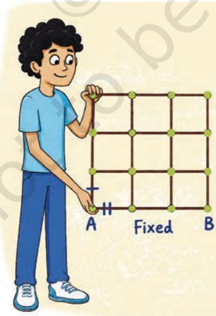
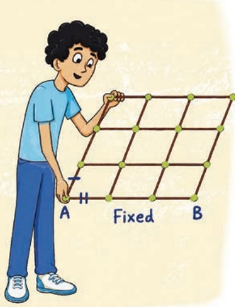

# Quadrilaterals

Quadrilaterals, which we also call 4-gons, occur everywhere in daily life. For example, we often see flooring made of square tiles. We say that the floor has been ‘tiled’ using those squares.

## Think and Reflect

Can we use any given quadrilateral to tile the plane? If not, which quadrilaterals can be used and which cannot?

Recall that **tiling** the plane means covering it with copies of the given shape or shapes without gaps or overlaps. Tiling the plane with a rectangle is easy, but it seems difficult with an irregular quadrilateral. We will answer the above question at the end of the chapter (can you do it now?) and understand the answer using what we learn in this chapter. However, to start with, we will discuss a simple new example of a tiling.

Imagine that tiling with rectangles is done using a grid of two sets of long wooden sticks, one set horizontal and the other set vertical. See Fig. 12.1A.

Fig. 12.1A

Fig. 12.1B