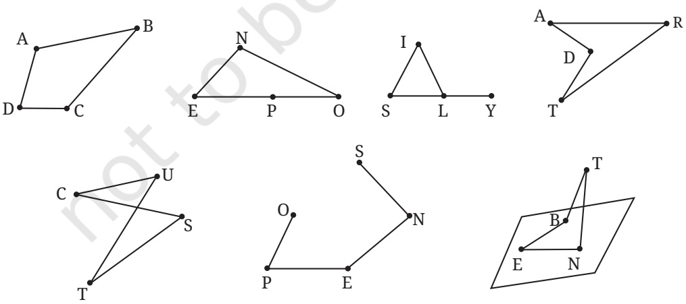

Fig. 12.2

These sticks are pinned together at each intersection point such that they are free to rotate about those points. Now suppose you pick up this grid. You hold the bottom stick fixed with one hand and push the vertical side with the other. See Fig. 12.1B. Each set of parallel lines will stay parallel but the angle between the two sets will no longer be 90°. Thus we see that the plane can be tiled using copies of any fixed parallelogram.

In this chapter, we will ask and answer several questions about quadrilaterals, paying particular attention to parallelograms. We will investigate their properties, examine ways to recognise them, and see important applications in geometry. At the end, we will answer the question above about whether one can tile the plane with a given quadrilateral.

## 12.1 What Exactly is a Quadrilateral?

## Think and Reflect

Informally, a quadrilateral is a figure with four straight sides, as in the first figure ABCD in Fig. 12.2 below. But consider the other six figures in Fig. 12.2: the five plane figures NOPE, SILY, DART, CUTS, OPENS and the non-planar BENT. Should we call all these figures quadrilaterals? If you answer ‘no’ for any of them, how will you define a quadrilateral so that such a figure is excluded? As you can see, some care is needed to precisely define what we think of as a quadrilateral.