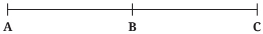

To prepare, let us first consider how we can define a triangle. Let A, B and C be three points. Can we say that ∆ABC consists of points on the three line segments AB, BC, CA? Yes, provided A, B, C are not collinear. Otherwise, we just get a line segment: see Fig. 12.3.

Fig. 12.3: Not a triangle

When A, B, C are non-collinear, we call them the **vertices** of ∆ABC and the three segments AB, BC and CA the **sides** of ∆ABC.

## Think and Reflect

Can we similarly define a quadrilateral ABCD?

Take any 4 distinct non-collinear points A, B, C and D. Will segments AB, BC, CD and DA always form a quadrilateral as we visualise it? See figures NOPE, SILY, DART, CUTS, OPENS and BENT in Fig. 12.2 again. Do you see, OPENS that there are some subtle new issues to consider?

First, to rule out examples like NOPE and SILY, no three vertices should be collinear. Otherwise, the two adjacent sides formed by the three collinear vertices will be along the same line, giving a triangle like NOPE or a figure with overlapping sides like in SILY.

Second, to rule out examples like BENT, all four vertices should be in the same plane. Four-sided figures like BENT are called **non-planar** quadrilaterals. We will study only planar quadrilaterals (except in a few exercises).

Third, do we want to call CUTS a quadrilateral? The answer depends on what we decide! Ordinarily, CUTS is not considered a quadrilateral. If we want to include it, we call it a self-intersecting quadrilateral.

Can you come up with a definition that rules out self-intersecting quadrilaterals like CUTS? Answer: we should require that all the points of the quadrilateral, other than the vertices, must lie on exactly one side.

Can you see how to rule out figures like OPENS?

Putting together all three requirements, we get the following definition.

**Definition 1.** Suppose A, B, C, D are four distinct points in a plane. Then the points on the 4 segments AB, BC, CD and DA are said to form **quadrilateral** ABCD if every such point other than A, B, C, and D lies on exactly one of these four segments.