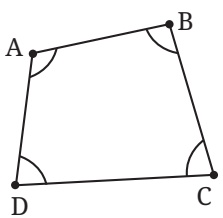
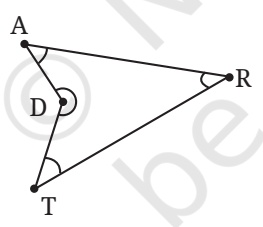
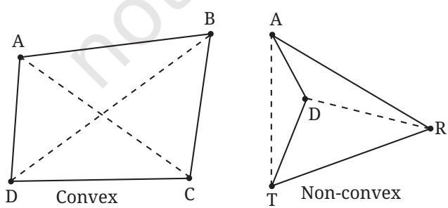

Now that we have precisely defined a quadrilateral, let us give similarly precise definitions of familiar terms associated with a quadrilateral.

A, B, C, D are called the **vertices** of quadrilateral ABCD; segments AB, BC, CD, DA are its **sides** or **edges**; segments AC and BD are its **diagonals**. The two endpoints of a side are called **adjacent vertices**. Two sides with a common endpoint are called **adjacent sides**. A quadrilateral has 4 **internal angles**, each formed at a vertex by a pair of adjacent sides. Internal angles at adjacent vertices are called a pair of **adjacent angles**. How will you define **opposite sides**? **Opposite angles**? See Exercise Set 12.1, Q1.

Note that quadrilateral ABCD can also be denoted as BCDA, CDAB, DABC, DCBA, ADCB, BADC or CBAD but not by any other sequence of vertices. (Draw ABCD and trace the vertices in various orders to see why.)

When we refer to a quadrilateral, we always mean a planar non-self-intersecting quadrilateral, unless stated otherwise.

## Convex Quadrilaterals

Should DART in Fig. 12.2 be considered a quadrilateral? It seems different from our usual mental picture of a quadrilateral because it has a dent, as if someone has taken a bite out of triangle ART! We call DART a non-convex quadrilateral.

All angles < 180°

∠D > 180°

A convex quadrilateral is one without a dent. How can we define this precisely? We can see in DART that at the dent at vertex D, the internal angle is more than 180°. So we call a quadrilateral convex when all of its internal angles are less than 180°.

Internal angles of convex and non-convex 4-gons

Fig. 12.4

Fig. 12.5

There are other ways of testing convexity. For example, visually verify that the diagonals of a convex quadrilateral intersect while those of a non-convex quadrilateral don’t intersect.