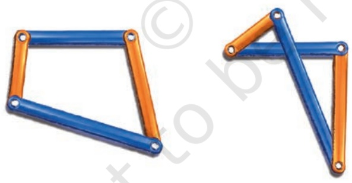
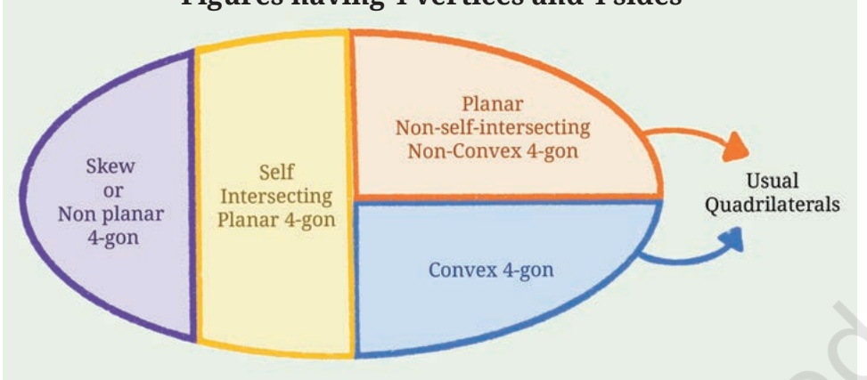
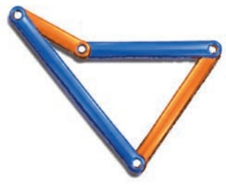

Figures having 4 vertices and 4 sides

Venn Diagram Representation

4-gons that do not fit your mental image of a quadrilateral may look strange. Do we really need to care about, e.g., self-intersecting 4-gons? Yes, because they do occur in real life, such as in 4-bar linkages. Linkages are widely used mechanical devices with several interlinked bars. Some ends of these bars are fixed, while other interlinked ends are free to rotate around the fixed ones. Search the internet for a video showing how linkages move. Linkages can attain a range of configurations, including non-convex and self-intersecting figures, as shown below. So engineers have to take such figures into account.

## Exercise Set 12.1

1. Let ABCD be a quadrilateral.

(i) List all sides of ABCD adjacent to side AB. List all sides opposite to AB.