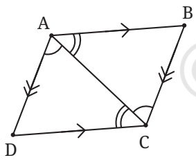
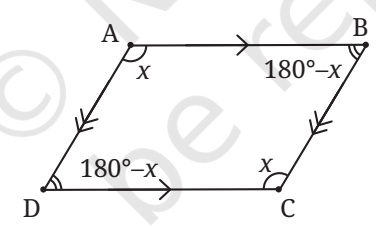
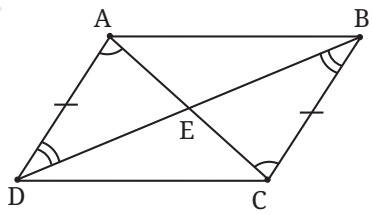

(a) If a quadrilateral is a parallelogram, then its opposite sides are equal.

**Converse:** If the opposite sides of a quadrilateral are equal, then it is a parallelogram. Is this converse statement true? Is this converse statement true?

(b) If a quadrilateral is a parallelogram, then the opposite angles are equal.

**Converse:** If the opposite angles of a quadrilateral are equal, then it is a parallelogram. Is this converse statement true?

(c) If a quadrilateral is a parallelogram, then its diagonals bisect each other.

**Converse:** If the diagonals of a quadrilateral bisect each other, then it is a parallelogram. Is this converse statement true?

Can you experiment and guess what the answers are?

It turns out that all three converse statements are true. To demonstrate this, it is useful to recall how we had proved Theorem 1:

**Proof of Theorem 1:**

(a)

(b)

(c)

Fig. 12.6

**Proof of (a):** In the parallelogram ABCD, AC is a transversal for AB ‖DC and also for AD ‖BC. So we get $\Delta  ACD \cong \Delta  CAB$ by the ASA test. Therefore, $\mathrm{AB} = \mathrm{DC}$ and $\mathrm { A D } = \mathrm { B C }$

**Proof of (b):** BC ‖AD with AB a transversal. Therefore $\angle \mathrm{A} + \angle \mathrm{B} = 180^{\circ}$ as they are interior angles on the same side of this transversal. By similar reasoning, any two adjacent angles add up to $1 8 0 ^ { \circ }$ . By using algebra, $\angle \mathrm{A} = \angle \mathrm{C}$ and $\angle \mathrm{B} = \angle \mathrm{D}$