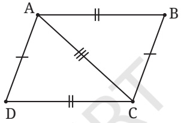
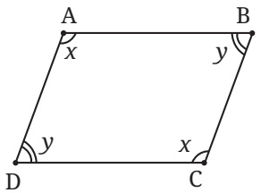

**Proof of (c):** Call the intersection point of the two diagonals E. Using property (a), $\Delta  AED \cong \Delta  CEB$ , by ASA or AAS. So EA = EC and EB = ED, which means that E is the midpoint of both diagonals.

We will now deduce the converse statements. To prove the converse of a known theorem, we can try to run the original proof backwards. This strategy may or may not work. (For example, the reasoning $\text{" If } x = y_{:}$ , then $x ^ { 2 } = y ^ { 2 }$ cannot be reversed, because x and y may have opposite signs, e.g., we could have x = 3 and y = –3.) When the strategy does work, we should be careful to give proper justification for each step in the backward direction.

**Theorem 2 (converse of (a)):** If the opposite sides of a quadrilateral are of equal length, then it is a parallelogram.

Fig. 12.7: Converse to (a)

**Proof:** Let ABCD be this quadrilateral. $\Delta  ACD \cong \Delta  CAB$ by SSS, so corresponding angles are equal. Using transversal AC, we get AB ‖DC and AD ‖BC.

Pay close attention to how the above proof retraces the proof of (a) backwards. Both proofs go via the same congruence $\Delta  ACD \cong \Delta  CAB ,$ but the two proofs use different tests to justify the congruence (ASA vs SSS) and draw different conclusions. Try to use the same ‘backward retracingʼ strategy for the remaining converses.

**Theorem 3 (converse of (b)):** If the opposite angles of a quadrilateral are equal, then it is a parallelogram.

**Proof:** Let ABCD be this quadrilateral. Because $\angle \mathrm{A} = \angle \mathrm{C}$ and $\angle \mathrm{B} = \angle \mathrm{D}$ we have

$$
360^{\circ} \mp \angle \mathrm{A} + \angle \mathrm{B} + \angle \mathrm{C} + \angle \mathrm{D} = 2(\angle \mathrm{A} + \angle \mathrm{B}) = 2(\angle \mathrm{B} + \angle \mathrm{C}).
$$

Fig. 12.8: Converse to (b)

$$
2(x + y) = 360^{\circ}
$$