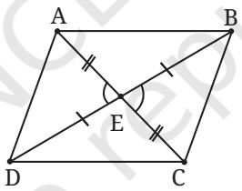
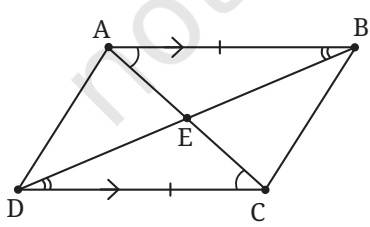

Therefore $\angle A + \angle B = \angle B + \angle C = 180^{\circ}$ . As in the proof of (b), we use the fact that AB is a transversal for the pair BC and AD. By $\angle \mathrm{A} + \angle \mathrm{B} = 180^{\circ}$ we deduce BC ‖AD. Similarly, we get AB ‖DC by using $\angle B + \angle C = 180^{\circ}$

## Think and Reflect

The angles of a quadrilateral add up to $3 6 0 ^ { \circ }$ Therefore, if the opposite angles are equal, what can we say about adjacent angles? Is the converse of your answer true? Conclude that Theorem 3 can also be stated as follows. “If each pair of adjacent angles in a quadrilateral ABCD…then ABCD is a parallelogram.” Fill in the blank.

**Theorem 4 (converse of (c)):** A quadrilateral whose diagonals bisect each other is a parallelogram.

**Proof:** Let ABCD be this quadrilateral. Let E be the intersection point of the diagonals AC and BD. As $\mathrm{EA} = \mathrm{EC}$ and $EB = \pm  DD$ , we have $\Delta  AED \cong \Delta  CEB$ by SAS. Now using $\angle DAE = \angle ECB$ along with transversal AC, we get AD ‖BC. Similarly, $\Delta  EAB  \cong \Delta  ECD$ gives AB ‖ DC.

Fig. 12.9: Converse to (c)

Finally, there is one more useful test to check if a given quadrilateral ABCD is a parallelogram.

**Theorem 5 (equal parallel sides test)**: A quadrilateral with one pair of equal and parallel opposite sides is a parallelogram.

Fig. 12.10

**Proof:** Suppose in a quadrilateral ABCD we have AB ‖DC and $\mathrm{AB} = \mathrm{DC}$ Let E be the intersection point of the diagonals AC and BD. (Why must the diagonals intersect? See Exercise Set 12.1, Q3.) We have $\Delta  EAB  \cong \Delta  ECD$ by ASA. So the diagonals bisect each other. By the converse of (c), ABCD is a parallelogram.