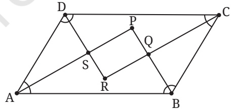

## Exercise Set 12.2

## 1. True or false?

(i) A parallelogram with a right angle is a rectangle.

(ii) A rhombus with perpendicular diagonals is a square.

(iii) If the diagonals of a parallelogram are equal, then it is a rectangle.

2. The diagonal AC of a parallelogram ABCD bisects ∠A. Show that it also bisects ∠C and that ABCD is a rhombus.

3. The following questions examine converses of true properties. Answer them with Yes or No. If your answer is No, what extra condition can you add so that the answer becomes Yes?

(i) If the diagonals of a quadrilateral ABCD bisect its angles, must ABCD be a rhombus?

(ii) If the diagonals of a quadrilateral ABCD bisect each other at right angles, must ABCD be a rhombus?

(iii) If the diagonals of a quadrilateral ABCD are of equal length, must ABCD be a rectangle? (In the ancient Indian study of quadrilaterals, equality of diagonals was considered significant. Quadrilaterals were first classified according to whether their diagonals were equal or not, before considering equality of sides.)

4. Let ABCD be a parallelogram with AB ≠ BC. Show that the pairwise intersection points of the four angle bisectors form the vertices of a rectangle (see Fig. 12.11). Why did we assume AB ≠ BC?

Fig. 12.11

## 12.3 Applications of Parallelograms

We saw that parallelograms have several nice geometric properties. These properties make the parallelogram a versatile shape with many real-world applications. In physics, a fundamental law uses parallelograms to combine certain physical quantities like forces, as you will learn in a later year. Parallelograms are used in several mechanical linkages, such as the parallel motion linkage discovered by James Watt,