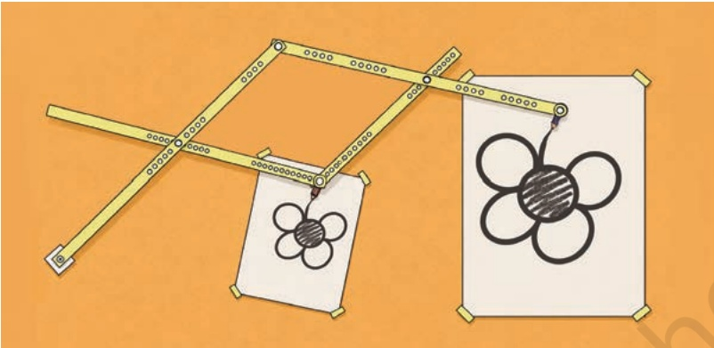
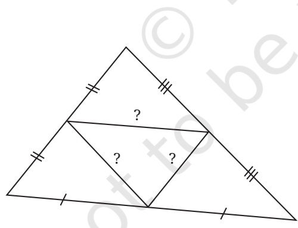

which formed an important part of his steam engine. His design used the concept behind another parallelogram-based device called a pantograph, which can make exact scaled copies of a drawing: search the internet for a video showing how a pantograph works. It is ingenious!

Schematic drawing of a pantograph

Parallelograms also serve as a powerful tool within geometry. Let us illustrate this by using parallelograms in a clever way to prove an important fact about triangles. We will discover this fact through exploration.

## 12.3.1 An Important Property of Triangles

Fig. 12.12

On a piece of paper, draw and then cut out two copies of the same triangle. Keep one copy aside. On the other, mark the midpoint of each side. (You can do this by folding the paper to join two vertices at a time.) Draw the triangle made by the three midpoints and cut the paper along each of these lines. Now you have four smaller triangles. Compare them to each other and to the intact copy of the original triangle. What do you notice?

It appears that all four smaller triangles are congruent to each other! And each seems to be a smaller copy of the original triangle. Verify that this pattern holds for triangles of other shapes.