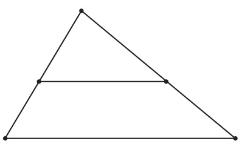
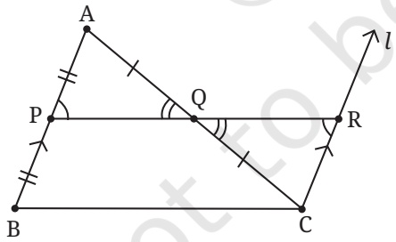

## Think and Reflect

Try to prove directly that the four smaller triangles are congruent. You will see that no congruence test applies, because many quantities are unknown.

Here is one idea. The difficulty might be because we are considering too many new things at once: three new points and three new segments. Can we try to break this down into steps?

Fig. 12.13

Let us see what happens with just one of the three new segments. Can you make a guess about this new segment, specifically about its direction and length compared with the unused third side? The triangles you cut earlier will help. It appears that the segment is parallel to the third side and has half the length! Let us try to justify this using reasoning.

**Geometric reasoning:** To set up, suppose that in ∆ABC, P and Q are the midpoints of side AB and AC respectively. Now comes the key idea. Construct the line l through C parallel to BA. Suppose it intersects line PQ at point R.

(See the comment about this line immediately after the statement of Theorem 6.)

Fig. 12.14

In ∆APQ and ∆CRQ, we have $\mathrm{AQ} = \mathrm{CQ}$ $\angle AQP = \angle CQR$ (vertically opposite angles), and

$\angle APQ = \angle CRQ$ (since AP ‖RC by construction).

$$
\mathrm{SO} \; \Delta \mathrm{APQ} \cong \Delta \mathrm{CRQ} \; \mathrm{by} \; \mathrm{AAS}.
$$

Therefore $PQ = QR$ (by ${ \mathrm { c o n g r u e n c e } } ) = { \frac { \mathrm { P R } } { 2 } }$ and $\mathrm{CR} = \mathrm{AP}.$ Combining $\mathrm{CR} = \mathrm{AP}$ with $\mathrm { A P } = \mathrm { B P } ,$ we get $\mathrm { C R } = \mathrm { B P } .$ Hence by Theorem 5