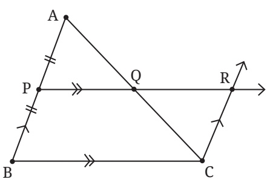
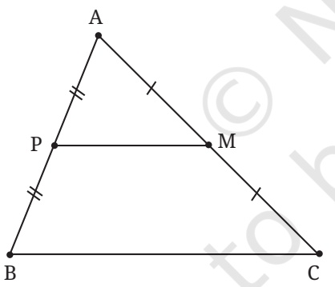

Fig. 12.15

BCRP is a parallelogram, so CR = BP. BP = PA and $\angle AQP = \angle CQR$ (vertically opposite angles).

Combining with CR ‖BA, ∆APQ ≅ ∆ CRQ. (Why?)

This gives two equalities.

First, AQ = QC, so Q is the midpoint of AC.

Second, PQ = QR, so $PQ = \frac{PR}{2} = \frac{BC}{2}$

We have deduced the following important fact. It can be considered a converse of the Midpoint Theorem, for reasons we will see in Exercise 22 at the end of the chapter.

**Theorem 7 (Converse of the Midpoint Theorem):** The line drawn through the midpoint of one side of a triangle and parallel to another side bisects the third side (and the resulting segment has half the length of the parallel side).

Let us see a different reasoning to justify Theorem 7. Read this short proof carefully.

Fig. 12.16

**Another proof of Theorem 7.** Recall our previous setup: the line parallel to BC through midpoint P of AB meets AC at point Q. Ignore this line for now and instead consider the midpoint M of AC. We want to show M = Q. We have PM ‖ BC by the Midpoint Theorem. Therefore line PM = line PQ, because there is a unique line parallel to BC through P. As lines PM and PQ coincide, they must intersect AC in the same point. Thus M = Q. This is what we wanted!

We used the Midpoint Theorem to prove its converse! This may look like cheating because, as emphasised earlier, the truth of a statement and of its converse are separate issues. But there is no mistake here. There is a key new point in this proof, namely that there is a unique line through a given point and parallel to a given line. This proof illustrates that sometimes we can use a theorem to prove its converse.