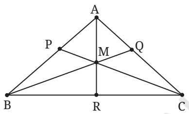
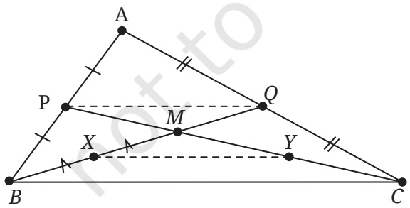

In Grade 10, we will generalise Theorem 7 by dropping the condition that P is the midpoint of AB and assuming only that PQ ‖BC. Can you guess the conclusion in this case? (**Hint:** the name of the more general theorem includes the word proportionality.)

## 12.3.2 A Surprising Property of Medians

The Midpoint Theorem allows us to deduce an important fact about triangles. Let us discover it experimentally. In ∆ABC, suppose P, Q and R are the midpoints of side AB, AC and BC respectively. Instead of joining the midpoints with each other as we did earlier, draw segments AR, BQ and CP. These are called the **medians** of ∆ABC. What do you see? Repeat this for several triangles and see that the three medians always seem to be concurrent, meaning they pass through a common point!

Fig. 12.17

There is more! Assume for the moment that the medians are always concurrent. Let M be the common point where they meet. Compare the lengths of the two parts CM and MP of the median CP, and do the same for the other two medians. Do you see a pattern? It appears that the ratio CM : MP = 2 : 1. We will now show why this is always true.

**Geometric reasoning:** It seems difficult to keep track of the three medians at once, so let us first examine only two medians CP and BQ. Call their intersection point M. We want to show that CM = 2MP and BM = 2MQ.

Fig. 12.18

We have not yet seen any theorem that gives a 2 : 1 division of a segment. The Midpoint Theorem only gives a 1 : 1 ratio. So to show that CM = 2MP, one idea is to bisect CM and try to show that the resulting three parts of CP are equal.

Let Y and X be the midpoints of CM and BM respectively. Now we can use the Midpoint Theorem in ∆ABC and in ∆MBC! We get