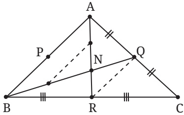
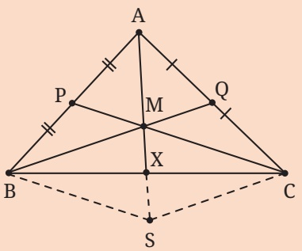

that PQ and XY are parallel to BC and hence to each other. Moreover $PQ = XY = \frac{BC}{2}$ . So $\Delta \mathrm{MPQ} \cong \Delta \mathrm{MYX}$ by ASA (How?). Therefore MQ = MX = XB and $\mathrm{MP} = \mathrm{MY} = \mathrm{VC}$ . This shows CM : $\mathrm{MP} = 2:1 = \mathrm{BM}:\mathrm{MQ}$

What about the third median AR? We can repeat the argument in the previous paragraph with medians AR and BQ! Let N be the point at which the AR and BQ intersect.

Fig. 12.19

Now the same reasoning gives BN : $\mathrm{NQ}=2:1=\mathrm{AN}$ : NR. (Use Fig. 12.19 if you wish to repeat the reasoning.) We already had BM : $\mathrm{MQ} = 2 : 1$ so $\mathrm{BM:MQ=2:1=BN:NO}$ . But this means M and N have to be the same point, because there is only one point that divides BQ in a given ratio. Thus M lies on all three medians and divides each median in the ratio 2 : 1. We have deduced the following important fact.

**Theorem 8: (Centroid Theorem)** The three medians of ∆ABC pass through a common point, which divides each of the medians in the ratio 2 : 1, with the longer part connecting to the vertex. This point is called the centroid of ∆ABC.

## Think and Reflect

Give another proof of the Centroid Theorem using a clever construction that we will describe only partly and ask you to complete. Once again let M be the intersection point of the two medians CP and BQ. We want to show that the intersection point of line AM with side BC is the midpoint of BC. For this, extend AM up to a carefully chosen point S such that BSCM becomes a parallelogram. (**Hint:** To arrange MC ‖ BS, first note that PM and MC are along the same line. Now where should M be on segment AS? Does your placement of S also prove MB ‖ CS?)

Fig. 12.20