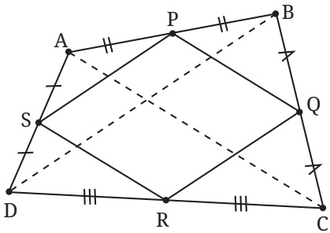
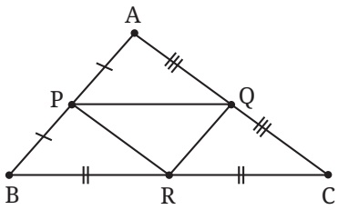

We started this section by examining the triangle formed by midpoints of the sides of a triangle. What happens if we use midpoints of the sides of a quadrilateral to make another quadrilateral? Experiment and see what this new quadrilateral looks like. It appears to be a parallelogram! Let us try to justify this using reasoning.

Fig. 12.21

**Geometric reasoning.** Suppose the midpoints of sides AB, BC, CD and DA of a quadrilateral ABCD are P, Q, R and S respectively. The Midpoint Theorem applied to ∆ABC and to ∆ADC gives, respectively, PQ ‖AC and SR ‖AC. So PQ ‖SR. Using the Midpoint Theorem in ∆BCD and in ∆BAD gives QR ‖PS. Therefore PQRS is a parallelogram.

We have deduced the following interesting fact, also known as Varignon’s theorem.

**Theorem 9 (Midpoint Theorem for Quadrilaterals):** The midpoints of the four sides of a quadrilateral are the vertices of a parallelogram. This is called the Varignon parallelogram of the original quadrilateral.

## Exercise Set 12.3

1. (i) If P, Q, R are the midpoints of sides AB, AC, BC respectively of ∆ABC, show that ∆PQR is congruent to ∆QPA and to two other triangles which you should identify.

(ii) Suppose someone erases $\Delta \mathrm { A B C } _ { i }$ , leaving only ∆PQR on the paper. Can you reconstruct $\Delta \mathrm { A B C }$ from $\dot { \Delta \mathrm { P Q R 2 } }$

Fig. 12.22