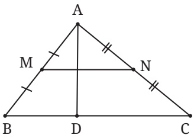
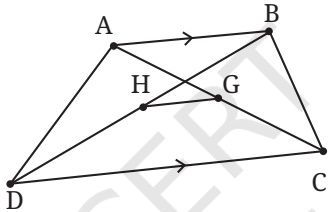
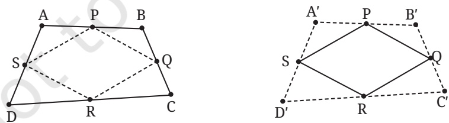

2. In $\Delta \mathrm { A B C } _ { ; }$ , let M and N be midpoints of AB and AC respectively. Let D be any point on BC. Show that MN bisects AD.

Fig. 12.23

3. In a quadrilateral ABCD, suppose AB ‖DC and $\mathrm { A B } \neq \mathrm { C D } .$ . Suppose G and H are the midpoints of AC and BD respectively. Prove that GH $\parallel \mathrm { A B }$ . (Why did we assume $\mathrm { A B } \neq \mathrm { C D ? ) }$

Fig. 12.24

4. Suppose the midpoints of sides AB, BC, CD and DA of a quadrilateral ABCD are P, Q, R and S respectively.

(i) Show that PR and QS bisect each other.

(ii) Show that if $AC = BD$ then PR and QS are perpendicular. Is the converse true?

5. Suppose PQRS is the Varignon parallelogram of ABCD.

Fig. 12.25

(i) Copy only PQRS on another paper. Show how you will recreate a congruent copy AʹBʹCʹDʹ of ABCD from PQRS. This will be relevant when we return to study tilings at the end of this chapter. (**Hint:** How will you place vertex Aʹ? How will you place Bʹ, Cʹ and Dʹ?)