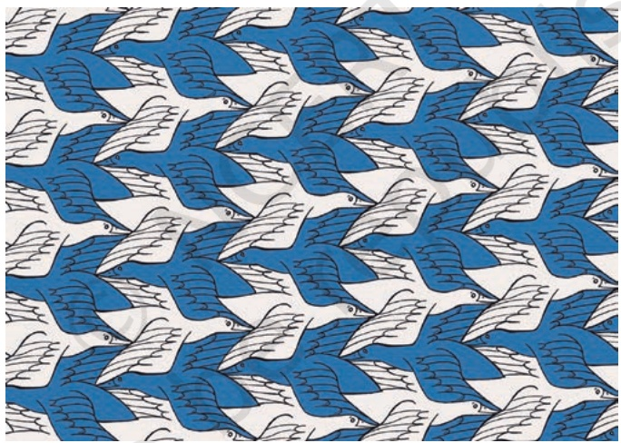
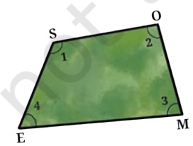

(ii) There are multiple ways to construct AʹBʹCʹDʹ in (i). Justify why the quadrilateral AʹBʹCʹDʹ you constructed is congruent to ABCD. You may need to show why S is collinear with the points Aʹ and Dʹ that you constructed, and similarly for P, Q and R. (**Hint:** Use congruence of triangles, for example ∆SDR ≅ ∆SDʹR. )

(iii) Show that if PQRS is a square, then AC and BD are perpendicular and equal. Prove the converse.

## 12.4 Tiling the Plane Using Any 4-gon

There are many ways to tile the plane, using a single shape or multiple shapes, leading to beautiful pictures. These occur in mosaics in several ancient civilizations to more recent artwork, such as that of M.C. Escher, in nature (for example, a honeycomb) and in decorative patterns we encounter in daily life.

Fig. 12.26

We will see how the plane can be tiled with any given 4-gon, not just a parallelogram as we saw at the beginning of the chapter.

Before you see the answer in Fig. 12.28, see the hints below and try to find a tiling using the given irregular 4-gon SOME. First, trace SOME on paper with its four angles labelled 1, 2, 3, 4. Remember that they add up to 360°. Cut out 15 identical copies.