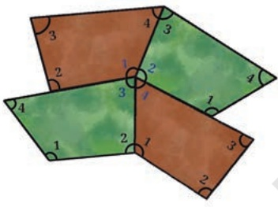
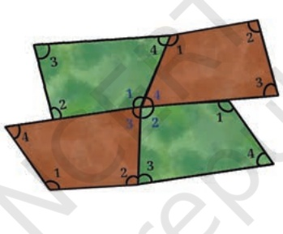
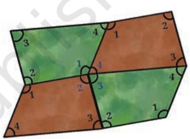
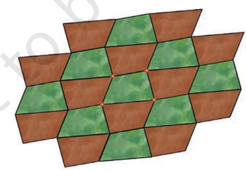

Throughout this section, we will focus on experimental verification of our methods. However, you are encouraged to try to prove, on your own, that they work.

## Think and Reflect

Suppose we have a tiling of the plane. Consider any vertex. As we go around this vertex and consider the angles made by consecutive lines, the total of these angles must be 360°. This suggests an idea. What if we take 4 copies of SOME and fit them together around a common point so that each angle is used once as we go around?

There are multiple ways of doing this, as shown in Fig. 12.27. Can you use any of these ways to continue fitting further copies of SOME to tile the plane? Try it with the 15 copies you made!

Fig. 12.27

Here is how one can tile! Recreate it with your pieces.

Fig. 12.28

How can we understand the figure? There seems to be a repeating pattern. (1) Can you precisely describe a procedure to draw the pattern