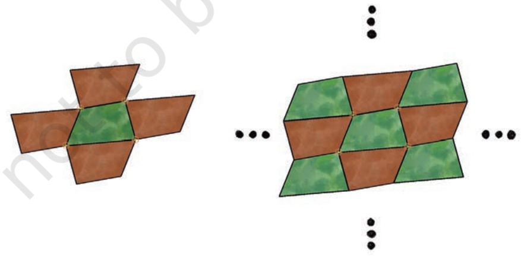
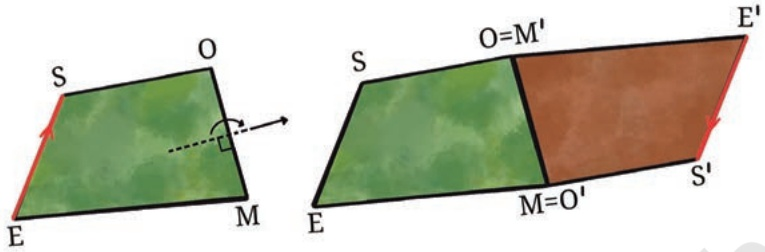

Fig. 12.30 A

Fig. 12.30 B

so that someone can draw the tiling on their own, based only on your description? (2) Can you justify why your procedure works?

We will sketch two methods and ask you to complete the details.

**Method 1:** We start with two copies of SOME, one exactly above the other. Rotate the top copy by 180° around the midpoint of OM. The rotated copy aligns with the original copy perfectly along the shared edge OM.

Fig. 12.29

Now repeat this procedure at each edge of every copy of SOME that you add. Verify that this will result in a tiling! Two steps of a possible continuation are shown in Fig. 12.30. The first step (Fig. 12.30 A) adds 4 copies around the starting copy and the second step (Fig. 12.30 B) adds 4 more copies. Note two interesting things about the second step: (1) each new copy can be obtained by rotating any one of its neighbours, and both ways give the same result. (2) The new copies fit perfectly. Can you explain these facts by reasoning? This is needed to prove that the method works!

Do you see which of the three possibilities shown in Fig. 12.27 occurs in the tiling?