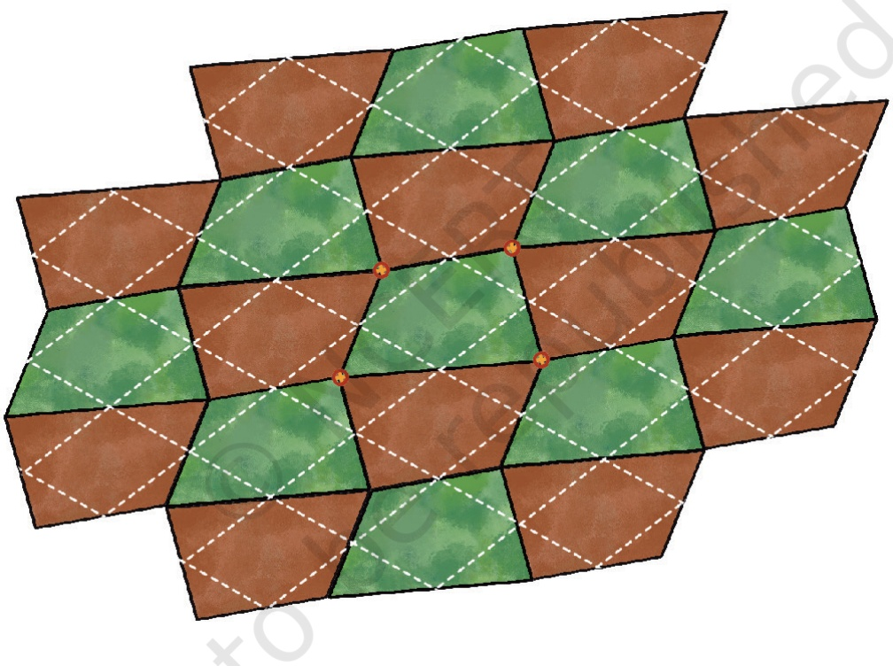

**Method 2.** Before we explain Method 2, let us conduct a thought experiment. Remember the Varignon parallelogram for 4-gons (Theorem 9). Imagine that we have drawn this parallelogram in each copy of SOME in the tiling shown earlier in Fig. 12.28. Visualise what the picture looks like. Fig. 12.31 shows the result: It appears that the Varignon parallelograms form a grid, giving the same parallelogram tiling we saw in the introduction!

This suggests an idea. What if we start by drawing just the simple grid tiling made by the Varignon parallelogram of SOME? Can we use this grid to construct the new tiling by SOME?

Fig. 12.31

A grid of Varignon parallelograms of SOME is given in Fig. 12.32. To begin with, focus only on the 9 green coloured copies of SOME in Fig. 12.31. We will first place only these 9 copies in Fig. 12.32. The corresponding parallelograms are shaded in Fig. 12.32. Place 9 copies of SOME so as to match the way the green coloured copies of SOME are placed in Fig. 12.31 (You were asked to give a precise description of how to do this in Exercise Set 12.3, Q5.) If done carefully, you will observe that each