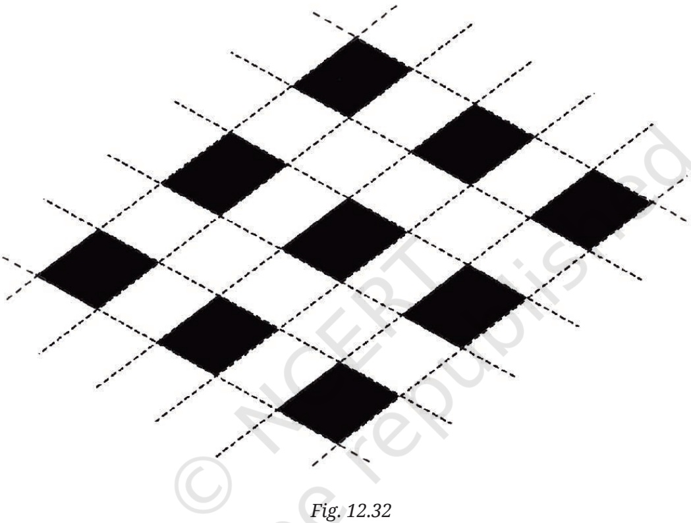

4-gon you placed meets other placed copies exactly at vertices. Now see how 4 copies of SOME are made automatically in the gaps! Carefully place four more copies of SOME in these gaps. Continuing this process with more copies of SOME will give us the desired tiling.

It should be emphasised that our procedure needs to be justified to assure us that it will always work. We will not do this here, but invite you to try it on your own!

Mathematicians have found many interesting ways to tile the plane using a small set of shapes. Some of these, called aperiodic tilings, turned out to be useful to describe atomic arrangements of quasicrystals—new physical structures that were discovered some time later. The discovery of quasicrystals, made by Dan Shechtman, was very surprising because the atomic arrangement was outside what was then considered physically possible. It led to a broader scientific understanding of the nature of order in solids. Dan Shechtman won the chemistry Nobel prize in 2011 for his discovery.