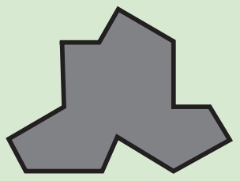
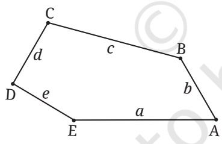
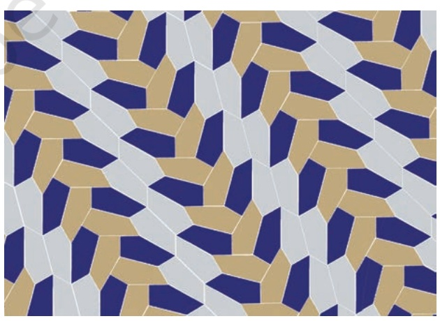

## A Cutting-edge Discovery

The following shape— the first of its kind!— that leads to aperiodic tilings was discovered only recently in 2023 by a team of four mathematicians (Smith, Myers, Kaplan and Goodman-Strauss).

Cut out 15 identical copies of the following shape (known as the ‘hat’) and start to tile with it. Do you see any pattern? You will find that the hat shape will tile the plane endlessly, but without ever quite repeating the same pattern. That is why it is called an ‘aperiodic’ tiling.

## Exercise Set 12.4

1. Justify why the plane cannot be tiled with a regular pentagon. (**Hint:** Read the first 3 sentences of ‘Think and Reflect’ in the section on tiling.) (There are many ways to tile the plane using a suitable irregular pentagon. The most recent method was found in 2015.)

$$
\begin{aligned} A  &= 60^{\circ} \\ B  &= 135^{\circ} \\ C  &= 105^{\circ} \\ D  &= 90^{\circ} \\ E  &= 150^{\circ}\end{aligned}\quad\begin{aligned}a &= 1 \\b &= \frac{1}{2} \\c &= \frac{1}{\sqrt{2}(\sqrt{3}-1)} \\d &= \frac{1}{2} \\e &= \frac{1}{2}\end{aligned}
$$

