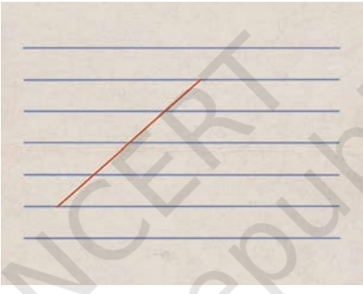
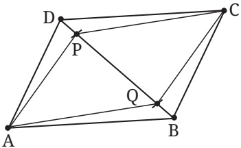

2. Draw a non-convex 4-gon DART. Show how we can tile the plane with copies of DART. Both methods that we discussed earlier will work. Which do you prefer?

## End-of-Chapter Exercises

1. Using a fact about parallelograms, show how to tile the plane using any given triangle. (**Hint:** Can you use the parallelogram tiling in the introduction?)

2. Mark the midpoint of the line drawn on the paper (see Fig. 12.33), given that the horizontal lines are equally spaced. Justify your answer.

Fig. 12.33

3. You know that the sum of angles of a quadrilateral is $3 6 0 ^ { \circ }$ , even for a non-convex quadrilateral. (Recall the proof.) Now consider a self-intersecting quadrilateral ABCD, where AB and CD intersect at point E. Show that $\angle A + \angle B + \angle C + \angle D < 360^{\circ}$ . Can you construct ABCD such that $\angle A + \angle B + \angle C + \angle D = 2^{\circ}?$

4. In a parallelogram ABCD, two points P and Q are taken on diagonal BD such that DP = BQ (see Fig. 12.34). Show that APCQ is a parallelogram.

Fig. 12.34