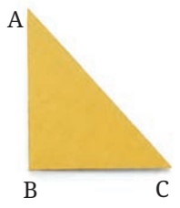
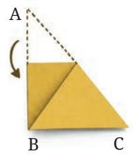

5. A right-triangle shaped cutout of a paper is folded such that point A touches point B (Fig. 12.35). Show that the crease line can be used to find the midpoint of not only AB but also that of AC.

Step 1 Step 2

Fig. 12.35

6. You saw how to use the Midpoint Theorem to divide a given triangle into 4 congruent triangles. Can we divide a triangle into 3 congruent triangles? This exercise shows us how to do that and more, provided we are allowed to cut and reassemble.

(i) Draw medians AP, BQ and CR of ∆ABC, meeting in a common point M. Cut along each median to get 6 triangles. Show with justification how to assemble the 6 pieces into 3 congruent triangles! (**Hint:** Align ∆MPB and ∆MPC along equal sides PB and ${ \mathrm { P C } } ,$ matching P with itself and B with C.) Prove that you get a triangle. What are its side lengths?

\*(ii) Repeat the procedure with each of the 3 assembled triangles you got in (i). Show that each of the resulting 9 triangles has sides $\frac{AB}{3}, \frac{BC}{3}$ and $\frac{AC}{3}$

The procedure and the result above were unnoticed till 2014, when they were discovered by Lee Sallows, an amateur mathematician!

(iii) Naturally, we can next ask about the possibility of cutting a triangle and reassembling it into 2 congruent triangles. You were asked this question in the chapter Measuring Space: Perimeter and Area. Can you solve this now? (**Hint:** Use median AP in ∆ABC and then a median of ∆APB.)

For any two given figures with straight sides, we can ask whether one figure can be cut (using only straight cuts) into pieces and reassembled to make the other. This notion is