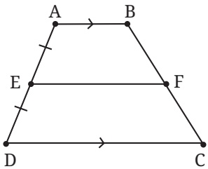
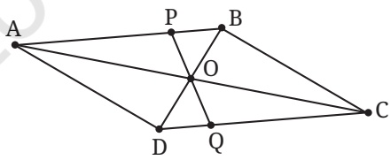

called scissors congruence. The figures need not be in the plane. Research on such questions at a higher level is ongoing.

7. **A more general midpoint theorem and its converse.** In a quadrilateral ABCD, suppose AB ‖DC. Recall that such ABCD is called a trapezium. Let E be the midpoint of AD. A line drawn through E intersects side BC at F.

Fig. 12.36

(i) If EF ‖ AB, then show that F is the midpoint of BC. Conclude that $\mathrm{EF} = \frac{(\mathrm{AB} + \mathrm{CD})}{2}$

(ii) If F is the midpoint of BC, then show that EF ‖ AB.

There are at least two ways to solve (ii). Do it directly by using the midpoint M of BD and showing that EM and FM are the same lines. Or use (i) along with the same idea used in the second proof of the converse of the Midpoint Theorem. Which way do you think is simpler?

8. The diagonals AC and BD of a parallelogram ABCD intersect at O. A line through O meets AB and CD at points P and Q respectively. Show that O is the midpoint of PQ. (Multiple proofs are possible. Which is the simplest?)

Fig. 12.37

\*9. ABCD is a trapezium with parallel sides AD = 3 cm and BC = 5 cm. E and F are the midpoints of the non-parallel sides. Find the ratio of the areas of the 4-gons AEFD and EBCF.