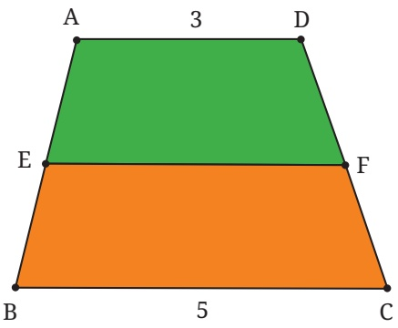
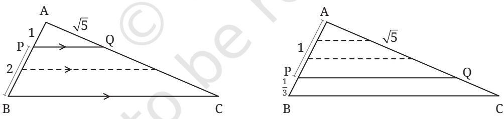

Fig. 12.38

10. Consider 4 points A, B, C, D in the plane with no three collinear. Answer the following questions. Some answers may require you to consider different cases, depending on how the points are positioned in the plane.

(i) How many different quadrilaterals do they form if the quadrilateral is allowed to be self-intersecting or non-convex?

(ii) How many of these quadrilaterals are self-intersecting? How many are convex?

11. Suppose P is a point on side AB of ∆ABC and the line through P parallel to BC meets AC in point Q. For parts (i) to (iii), assume $\mathrm{AP} = 1, \mathrm{AQ} = \sqrt{5}$ , and see Fig. 12.39.

Fig. 12.39

(i) If PB = 2 find QC. (**Hint:** See the dotted line)

\*(ii) $\mathrm { I f }   \mathrm { P } \bar { \mathrm { B } } = \frac { 1 } { 3 }$ find QC. (**Hint:** See the dotted lines)

\*(iii) If $\mathrm { P B } = { \frac { 2 } { 3 } }$ find QC.

(**Hint:** Divide both PB and AP suitably.)

\*(iv) Show that if $\frac { \mathrm { A P } } { \mathrm { P B } }$ is a rational number, then $\frac{\mathrm{AP}}{\mathrm{PB}} = \frac{\mathrm{AQ}}{\mathrm{QC}}$ . In Grade 10, you will prove this equality without assuming $\frac { \mathrm { A P } } { \mathrm { P B } }$ is rational. That will require a new idea.