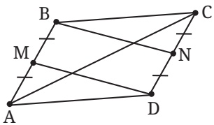
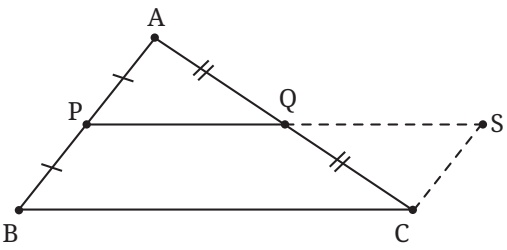

12.  (i) Suppose ABCD is a parallelogram and M, N are midpoints of AB and CD respectively. Show that segments DM and BN trisect segment AC.

(ii) Use part (i) to find a procedure to trisect any given segment PQ. Find two other ways to trisect PQ, one using Exercise 11 above and a third using the Centroid Theorem.

Fig. 12.40

13. Is the Midpoint Theorem for Quadrilaterals (Theorem 9) true when the quadrilateral is non-convex? How about when it is self-intersecting? Experiment and check. The pictures may look strange, but the theorem appears to be true.

(i) Can you explain why this is so? See the geometric reasoning in the text.

(ii) There is one exception: In a very special case the Varignon parallelogram becomes a single segment. When will this happen?

\*(iii) Does your reasoning apply even when ABCD is non-planar?

14. Let P, Q, R, S be four points on sides AB, BC, CD and DA respectively of a quadrilateral ABCD. Suppose PQRS is a parallelogram. Must P, Q, R and S be midpoints of the respective sides? This can be considered a possible converse question to Theorem 9.

15.  (i) Complete the following proof of the Midpoint Theorem. Extend segment PQ beyond Q until point S. By how much should we extend PQ?

Fig. 12.41