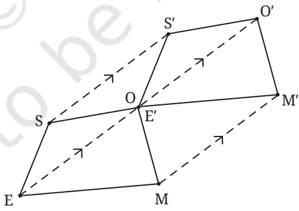

It would be good to be able to prove that $\Delta \mathrm{APQ} \cong \Delta \mathrm{CSQ}.$ (Why?) Use this as a guide to specify the location of S and then complete this proof.

(ii) Give a similar proof of the converse of the Midpoint Theorem (Theorem 7). Start by extending PQ up to a suitable point S.

\*16. Review all the properties of a rhombus/rectangle/square that you proved in Grade 8. Formulate a converse of each. Decide if the converse is true. There are many possibilities here!

\*17. Show that the sum of angles of a non-planar quadrilateral is always less than 360°. Can you find a non-planar quadrilateral ABCD for which $\angle A + \angle B + \angle C + \angle D = 2^{\circ}?$

(**Hint:** Think of a diagonal, say AC, as a hinge around which triangles ABC and ADC can rotate.) What happens to each angle of ABCD as you do this rotation?

\*18. Let us see a third method to tile the plane using a 4-gon.

Focus on only two coloured copies of SOME sharing a vertex. What do you see? It appears that each 4-gon is just a shifted copy of the other. Let us see exactly how. Draw two copies of SOME as shown in Fig. 12.42 so that the diagonals EO and EʹOʹ are collinear with O = Eʹ. Now place a cutout of one copy on top of SOME with diagonal EO drawn on it. Slide this cutout so that segment EO moves along EOʹ until EO matches EʹOʹ. Verify that your cutout exactly matches SʹOʹMʹEʹ.

Fig. 12.42

(i) Prove the exact match of SOME with SʹOʹMʹEʹ using four parallelograms.

(ii) Follow the described procedure along each diagonal of the starting coloured 4-gon in both directions to get 4 new 4-gons. Using these 4 copies, repeat the procedure 4 more